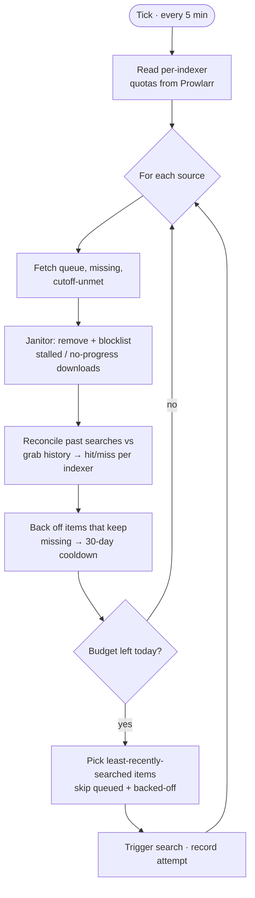

# Warden

Warden hunts for missing movies and episodes in Radarr and Sonarr — and cleans up
the download queue — without tripping your indexers' rate limits. It replaces newtarr.

The problem with naive hunters is that they hammer the search endpoint, get the
indexers banned in Prowlarr, and then find nothing. Warden meters itself against the
*actual* per-indexer daily limits Prowlarr enforces, spreads its searches across the
day, and never re-searches something it already has queued.

## What it does each tick

A tick runs every 5 minutes. For each instance (radarr, sonarr) it does the janitor
work first — which costs no quota — then hunts only if there's budget left.



The janitor runs every tick even when quota is exhausted, so a stuck queue gets
cleaned regardless of how much hunting is left.

## How the budget works

Every search hits *all* of a source's synced indexers, so the binding limit is the
**smallest** per-indexer daily cap among them (read live from Prowlarr, minus a
reserve). Warden tracks what it has spent today and paces the rest evenly until the
daily reset — so it drips searches out instead of burning the budget at midnight.

If Prowlarr is unreachable it falls back to a flat per-day budget.

## The janitor

- **Stalled** — Radarr/Sonarr flag a download `warning` + "stalled with no connections"
  past a grace period → remove and blocklist so it can re-grab a different release.
- **No-progress** — a download whose `sizeleft` hasn't moved past a floor over a window
  → same treatment. Slowly-progressing downloads are left alone.
- A guard bails the whole sweep only when the *download client itself* is unreachable
  (`downloadClientUnavailable` over half the queue), so warden never deletes data
  during an outage.

## Space guard

Warden can pause hunting when the disk is running low, so it stops asking for new
releases before the drive fills. Each tick it reads the smallest free space across a
source's *arr root folders and subtracts the bytes still downloading in that source's
queue (in-flight grabs that haven't landed yet); if that **projected headroom** falls
below `WARDEN_MIN_FREE_GB`, hunting is skipped for the tick. The janitor still runs, so a
full disk keeps getting cleaned while hunting is paused.

The guard is **off unless `WARDEN_MIN_FREE_GB` is set** — there is no default floor. If a
root folder's free space can't be read (endpoint error, or all folders inaccessible),
warden hunts anyway rather than freeze. `warden_space_blocked`, `warden_free_bytes`, and
`warden_projected_free_bytes` expose the state per source.

## Search efficacy & backoff

Warden correlates each search it fires against Radarr/Sonarr grab history: a grab for
that item afterward is a **hit** (attributed to the indexer that delivered it); no grab
within the resolve window is a **miss**. After 3 straight misses an item is assumed
unfindable and parked for 30 days, so scarce quota goes to things that can actually be
found. A grab resets the streak.

## State

SQLite at `/state/warden.db` (survives restarts):

| Table | Holds |
|----------------------|-------------------------------------------|
| `search_ledger`      | searches spent per source per day         |
| `queue_progress`     | no-progress anchors per download          |
| `search_attempt`     | searches awaiting hit/miss reconciliation |
| `search_backoff`     | miss streaks + cooldown expiries          |

## Commands

From `app/`, use the unified CLI:

```bash
uv run warden
uv run warden serve
uv run warden profiles dump --source radarr --output /local/profiles
uv run warden profiles validate --directory /local/profiles
uv run warden profiles diff --source radarr --directory /local/profiles
```

With no arguments Warden prints help. `serve` starts the HTTP server, hunter, and
configured profile observer. Profile commands run once and exit without starting
the server or initializing its SQLite database. Settings still come from the
environment. Both `warden` and `python -m warden` use the single CLI entry point.
The earlier development entry points `python -m warden.main` and
`python -m warden.profiles.cli` have been removed; use `warden serve` and
`warden profiles ...` respectively.

To install the command outside the checkout, run `uv tool install .` from `app/`
(Python 3.12 or newer). You can then run `warden serve` or `warden profiles ...`
directly. `python -m warden` provides the same interface. Packaging uses
`uv_build`, including the profile JSON schemas; no setuptools dependency is added.

Docker uses `warden` as its entry point and defaults to `serve`. Override its
arguments to run a one-time command, for example `docker run --rm <image> --help`.
Profile commands need the same environment settings and profile mounts described
in the [profile guide](PROFILES.md).

## Profile configuration (in development)

Profile management provides standalone, read-only Arr export, local configuration
validation, semantic comparison, and optional Git or read-only directory observation in a separate
loop. See [profile configuration usage and format](PROFILES.md), including runtime Git
requirements. Profile work does not use the hunter's SQLite database.
Legacy import and synchronization are not yet implemented.

`container.py` is the composition root. Dependency Injector providers construct
Arr clients, services, repositories, profile storage/codecs/sources, Git/cache,
the observer, and server dependencies. The hunter and profile service share the
same configured Arr clients. Source selectors instantiate only the selected
implementation, and profile commands do not resolve server configuration or SQLite.

`cli.py` uses `build_parser()` to associate each subcommand with a small async
handler through `set_defaults(func=...)`. Each handler declares its dependencies
with `@inject` and `Provide`; operations stay in shared profile operations and runtime
modules. A common runner reports errors and shuts down initialized resources on
success, failure, or cancellation. `main()` creates the container, invokes the
selected handler, and writes output and exit status. The container declares wiring
for CLI handlers and HTTP routes; the CLI does not register API dependencies.
The HTTP client uses a Resource provider to own its async context.
`api/app.py` registers the health and metrics routes from `api/routes/`.
`serve.py` receives the server, stop signal, and loop callbacks and coordinates
the HTTP server, hunter, and profile observer. The profile loop
receives settings and observer providers so invalid or disabled observation never
forces source/cache construction or stops hunting. Provider overrides reach these
same dependencies in unit tests.

Within `warden/profiles`, `models.py` defines documents and snapshots;
`validation.py` checks their relationships. `operations.py` coordinates dump and
diff using an injected `ProfileStore` and `ArrService`, independently of CLI or
HTTP concerns. `cli_output.py` owns terminal text, JSON output, and exit status.
Profile operations are currently exposed through the CLI; there are no profile
HTTP endpoints.

`ProfileStore` in `files.py` owns local loading and guarded export publication.
`reading.py` coordinates bounded reads and decoding as a function with supplied
dependencies; `codec.py` adapts YAML/JSON and JSON Schema. `sources.py` provides
local-directory and Git-backed snapshots. The Git source coordinates an injected
`GitClient`, `SnapshotCache`, and store: Git execution, cache accounting/cleanup,
and adoption of validated revisions have separate responsibilities. `storage.py`
separates mount lookup from the allowed-filesystem policy.

Unit tests can verify byte limits with tiny byte strings, Arr reads with mock
clients, and snapshot replacement with mock Git/cache/store dependencies. Unit
test paths mirror the modules they exercise. CLI integration tests exercise the
concrete adapters together, including failure and storage-protection behavior.

## Configuration

All via `WARDEN_*` env vars. Instances are discovered from `WARDEN_RADARR_URL` /
`WARDEN_RADARR_API_KEY` (and the `SONARR` equivalents).

`pydantic-settings` handles typed defaults, environment conversion, and field
validation. Server and profile settings are loaded separately from the container's
environment snapshot; an injected mapping does not inherit missing values from the
process environment. `EnvironmentSettings` shares that source policy and suppresses
input values in validation errors. Warden does not load `.env` or secrets files
through the settings models.

Boolean settings accept `true`/`false`, `yes`/`no`, `on`/`off`, and `1`/`0`, ignoring
case and surrounding whitespace. Unrecognized values now fail validation instead
of silently becoming false. Invalid server settings report the field before
startup; invalid profile settings continue to leave hunting running. Timezone and
database fallbacks, blank free-space settings, and disabled observation retain
their existing behavior.

| Var | Default | What |
|-----|---------|------|
| `WARDEN_POLL_INTERVAL_SEC` | `300` | seconds between ticks |
| `WARDEN_RESERVE_PCT` | `20` | quota held back from the indexer limit |
| `WARDEN_RESET_AT_LOCAL` | `00:00` | when the daily budget resets |
| `WARDEN_MIN_FREE_GB` | _(unset)_ | pause hunting when projected free disk drops below this (GB); unset disables the space guard |
| `WARDEN_STALE_GRACE_HOURS` | `48` | age before a stalled item is removable |
| `WARDEN_STALE_NO_PROGRESS_HOURS` | `12` | how long an item must stay completely frozen before removal |
| `WARDEN_STALE_JITTER_TOLERANCE_MB` | `0` | drain below this counts as frozen (`0` = any progress resets the clock) |
| `WARDEN_EFFICACY_RESOLVE_MINUTES` | `30` | how long to wait for a grab before scoring a miss |
| `WARDEN_BACKOFF_MISS_THRESHOLD` | `3` | misses before an item is parked |
| `WARDEN_BACKOFF_COOLDOWN_DAYS` | `30` | how long a parked item stays excluded |

Each feature has an `_ENABLED` toggle (sweep, no-progress, efficacy, backoff).

## Observability

- `/healthz` and `/metrics` on port 9090.
- Prometheus scrapes `warden_*` metrics; the "Warden — *arr Hunter" Grafana dashboard
  shows budget, queue health, search hit-rate per indexer, and backed-off counts.

## Layout

```
warden/
  clients/       Radarr/Sonarr/Prowlarr HTTP
  repositories/  SQLite persistence
  services/      tick logic (pure, testable)
  api/           HTTP app setup and health + metrics routes
  cli.py         argument parsing and injected command handlers
  cli_output.py  terminal output and exit status
  serve.py       HTTP server and background-task lifecycle
  profiles/      shared profile operations and observation
  container.py   dependency construction and wiring
  models.py      shared dataclasses
```

Imports flow `api → services → repositories → clients` (enforced by import-linter).
Unit tests cover the logic; the integration suite (`tests/integration`, marked
`@pytest.mark.integration`) invokes the installed `warden` executable against
local *arr HTTP fixtures. Run it with `task test:integration -- warden`; it also
runs in CI as part of each build.

- `test_api.py`: health and metrics over HTTP from a running `warden serve`.
- `test_cli.py`: help and command-line errors.
- `test_cli_profiles.py`: validation, dump, and diff through `warden profiles`.
- `test_cli_serve.py`: hunting, observation, recovery, metrics, and shutdown through
  `warden serve`.

Integration tests assert exit codes, stdout/stderr, files, HTTP requests, and
scraped metrics. They do not import Warden components or construct profile configuration with
production helpers. Git fixtures are bootstrapped through `warden profiles dump`.
Package, image, and deployment checks live under `tests/e2e`; pure comparison and
validation rules retain their unit tests.

Coverage includes the CLI child processes and server startup code. The combined
unit/integration run retains the 90% coverage requirement; selecting a single
tier does not enforce the whole-application gate.
